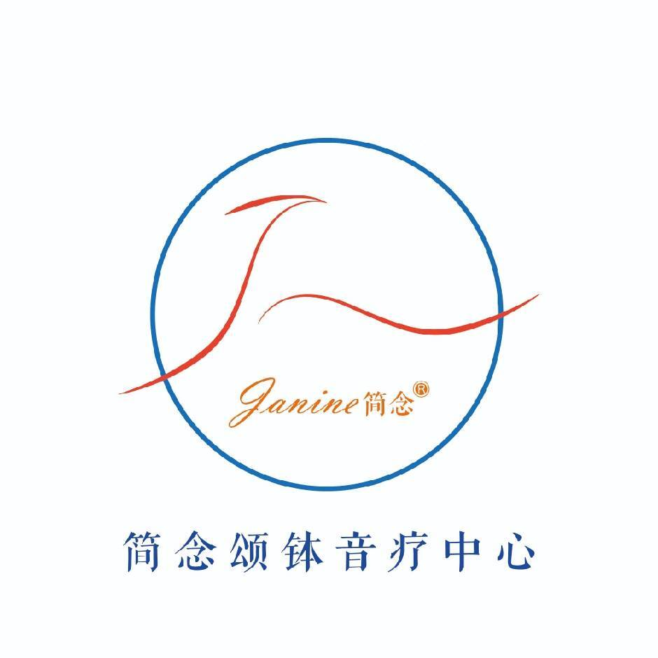

# 简念® 品牌与理念介绍

---

## 一、品牌标识

| 项目 | 内容 |
|---|---|
| **品牌名** | 简念（Janine®） |
| **英文名** | Janine |
| **Logo** | 由英文首字母 **J** 设计而成，注册商标 |
| **所属机构** | 简念颂钵音疗中心（2019 年创立于上海） |
| **创始人/导师** | 乔忠乾 |
| **培训认证** | 国家职业证书 + 简念颂钵音疗双证体系 |

---

## 二、品牌名释义

**中文：简念**

- **简** —— 简约、纯粹、回归本真
- **念** —— 今心为念。念字拆开，上"今"下"心"，即**当下之心**

**英文：Janine** —— 无英文释义，为品牌专属命名

---

## 三、品牌口号

**简单呼吸 正念虔行**

---

## 四、核心理念：呼吸之间的正念觉知

### 1. 呼吸是正念觉知的入口

在颂钵疗愈的过程中，呼吸节奏只是技术形式之一，**更重要的是呼吸带来的正念觉知**。每一次敲击、每一次移动、每一次共振，都是经由呼吸回到当下的练习。

### 2. 呼吸是当下的长度

**何为当下？呼吸之间就是当下的长度，也是生命的刻度。**

- **念 = 今 + 心 = 当下之心**
- **一念三千**：每一次呼吸之间，足以感受三千大千世界

### 3. 呼吸是修行的根基

无论是整个修行的根基，还是瑜伽的灵魂，最终都指向觉知。禅修入门是观呼吸，而生命的真谛亦是经由觉知回到当下。

> 佛陀曾问弟子：生命几何？仅在呼吸之间。

生命的长度是呼与吸的连续，生命的质感是每一次呼吸中的觉知分辨率。

### 4. 简单呼吸的疗愈力

当你明白了呼吸这个法门——不是学会某种固定的节奏或技巧，而是**经由呼吸建立正念觉知**——疗愈自然发生。**简单呼吸，就是最深层的疗愈。**

---

## 五、品牌与颂钵疗愈的合一

简念颂钵音疗中心将这一正念觉知哲学融入颂钵疗愈的全流程：

- **起始**：每一次疗愈从调息开始——疗愈师与被疗愈者经由呼吸，共同回到当下
- **过程**：颂钵的敲击、移动、共振，皆以正念觉知为内在核心；呼吸节奏只是外在形式之一
- **终点**：疗愈结束于一次深长的觉知呼气，回归当下的圆满

**简单呼吸，正念虔行**——这是简念颂钵音疗中心对所有学员和疗愈师的终极指引。

---

*简念颂钵音疗中心 © 2019–2026 | 导师：乔忠乾*