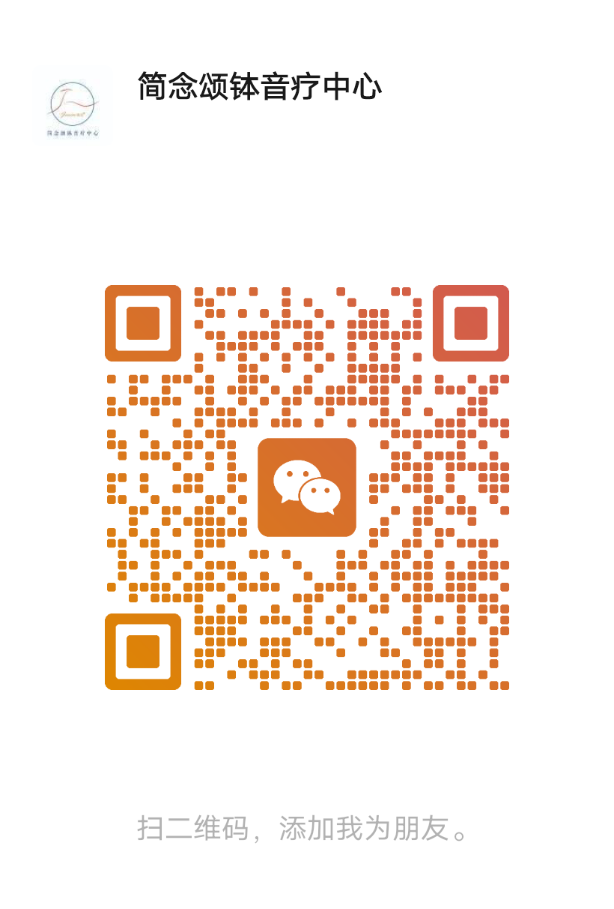

# 实操学习路径：线上可学 vs 线下必学

> **品牌**：简念颂钵音疗中心 | **培训认证**：国家职业证书 + 简念颂钵音疗双证体系
>
> **阅读对象**：所有自学读者、预报名线下培训的学员、以及培训讲师。
>
> **核心结论**：本教材第三章「实践操作」的理论框架、原理与安全边界可以线上学习；**具体手法细节属线下面对面授课内容，不适合单纯线上自学**——文字无法传导操作手感、力度分寸、即时判断与安全边界，盲目模仿容易误入歧途。

---

## 一、为什么实操部分必须线下学

颂钵疗愈的实操属于**技能型（hands-on）知识**，与书本理论有本质区别：

| 维度 | 线上文字/视频能覆盖 | 必须线下面对面传导 |
| --- | --- | --- |
| 持钵与敲击 | 概念、姿势描述 | 手腕角度、力度轻重、落点位置的体感校正 |
| 身体接触分寸 | 禁忌名单、穴位名称 | "重一分则痛、轻一分则无效"的现场手感 |
| 被疗愈者实时反馈 | 常见反应的理论描述 | 面色、呼吸、肌肉张力的即时观察与调整 |
| 能量感知与引导 | 理论框架 | 师生同场共振中的感知校准 |
| 定制化方案 | 方案类型清单 | 因人因症排钵、选钵与流程变通的案例教学 |
| 安全控制 | 警告清单 | 错误操作现场纠正，避免越练越偏 |

单纯靠线上资料自学并"照着做"，风险包括：力度不当造成身体不适、体位或疗程节奏错误、禁忌把握不准而伤害敏感人群、以及将未经校对的自我感觉误当作"疗愈效果"。

## 二、线上可学的内容（放心自学）

以下内容**不用等线下课**，现在就可以线上学习：

1. **第一章 颂钵基础**：钵的类型、选钵鉴别、周边配件、请钵/持钵/敲钵/磨钵/移钵/止音等基础动作要领说明。
2. **第二章 理论课题**：声音基础、振动基础、能量基础（三脉七轮、五大元素）、疗愈原理、脉轮节奏、穴位经络的**知识层面**。
3. **第三章的理论框架与安全边界**：各类案例实操的**原理、适用人群、禁忌清单**——例如"失眠头痛适合哪种疗法、哪些人群不适合"这类信息。
4. **配套文档**：
   - [实操速查表](实操速查表.md)（方法名称、适用对象、注意事项速览）
   - [安全指南](安全指南.md)（禁忌清单、操作前检查表、穴位安全补充）
   - [音乐会流程](音乐会流程.md)（净手/场域/行钵的整体流程框架）
   - [常见问题](常见问题.md)、[章节自测题](自测题.md)
   - [参考文献](参考文献.md)（了解论据来源，培养循证思维）

> 线上学习的正确姿势：把第三章当作**预习材料**，理解"疗愈逻辑与流程框架"，而不是操作指南。学完用 [实操记录模板](实操记录模板.md) 记录自己的理解与疑问，带到线下课核对。

## 三、线下必学的内容（预约培训）

以下内容教材中**刻意留白**或仅标注"笔记区/见培训课堂笔记"，属于**面对面授课范畴**：

- **气场清理类**：眉心轮净化、督脉净化、三脉净化（3.1.1）
- **空间净化类**：场域净化、能量水、能量花的具体制作与操作（3.1.2）
- **单钵疗愈案例**：放空减压、静心冥想、清肠排便、疏通肩颈、缓解痛经、太空人疗愈等的具体手法（3.1.3）
- **经络疏通类**：膀胱经、督脉、心轮舒压、疏肝理气、带脉疏通等（3.1.4–3.1.10）
- **专项调理类**：失眠头痛、长期偏头痛、女性妇科调理、女性保养类等（3.1.11–3.1.15）
- **组合疗法**：三钵、七钵综合疗法（3.1.13–3.1.14）
- **颂钵音乐会演奏**：行钵流程、满月钵/铜锣浴等乐器配合（3.2）
- **个案精品体验流程**：自我能量保护 → 课前沟通 → 行钵 → 背部/正面疗愈 → 撤钵 → 唤醒（3.3）

## 四、安全边界（先读再学）

无论线上还是线下，请先阅读并遵守：

1. **颂钵疗愈是辅助性自然疗法**，不能替代医疗诊断与治疗；有健康问题先咨询执业医师。
2. **禁忌优先**：孕期、月经期、炎症感染期、心脏病、高血压、术后/金属植入、皮肤破损等情形，对不同操作各有明确禁忌——详见 [安全指南](安全指南.md) 第八、九章。
3. **接触式操作红线**：涉及身体的接触式手法（尤其腹部、胸腹、背部、头面部）必须经线下培训合格后方可实施；**未接受培训前，严禁对他人实施接触式操作**。
4. **能量水用途**：教材中能量水仅用于**净手仪式**，非饮用水源。
5. 状态不佳（疲劳、情绪剧烈波动、饮酒后）时不操作、不被操作。

## 五、线下培训衔接入口

- **参加培训**：教材由「简念颂钵音疗中心」（导师：润泽老师）提供系统线下培训课程；具体开课时间、地点与报名方式，请通过下方二维码联系获取。
- **多对一咨询**：扫码添加公众号后，可直接咨询课程安排、试听课或师资认证。
- **线下学习时**：携带本教材打印版或电子版 + [实操记录模板](实操记录模板.md)，边学边记录课堂笔记，对照 [实操速查表](实操速查表.md) 逐项勾销。

> 二维码来源：课程主办方提供的官方微信公众号添加入口。

## 六、给培训讲师的使用建议

- 将第三章的"笔记区/留白"作为**课堂授课大纲**：每处留白对应一个现场示范 + 学员实操 + 纠错环节。
- 学员课前先线上学习第一、二章与第三章的框架，线下课聚焦手法校正与案例演练，提高课堂效率。
- 结业考核后，指导学员用 [实操记录模板](实操记录模板.md) 完成首个真实个案记录，作为进阶能力凭证。