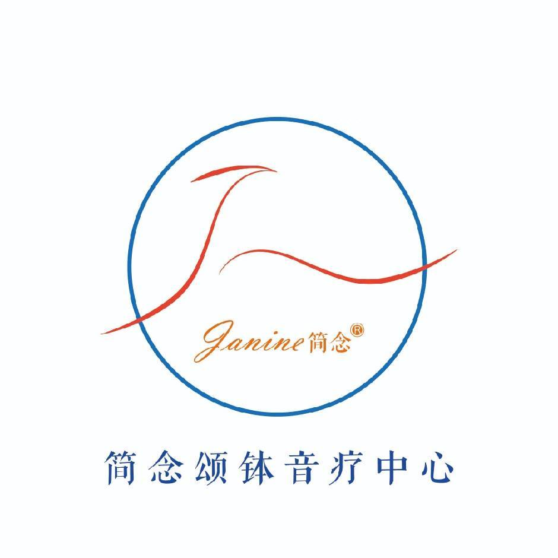
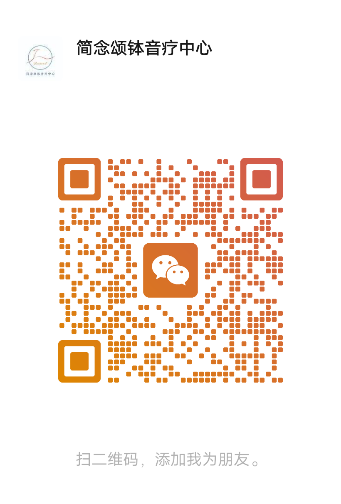

# 简念颂钵音疗中心 —— 颂钵疗愈师培训招生简章

> 📄 **精美图文版**（杂志排版，含二维码与报名入口）：[招生简章 · 精美图文版](../招生简章.html)

---

## 一、关于简念



**简念颂钵音疗中心**创立于2019年5月，总部位于上海，是中国第一家以颂钵为主题的音疗中心。

品牌名**"简念"**取自"简单呼吸，正念虔行"——呼吸是正念觉知的入口，也是颂钵疗愈的起点与终点。

- **图形商标注册号**：60187587
- **文字商标注册号**：27966528
- **品牌口号**：简单呼吸 正念虔行
- **品牌释义**：念 = 今 + 心 = 当下之心；一念三千，呼吸之间感受三千大千世界

> 详见 [品牌与理念介绍](品牌与理念.html)

---

## 二、课程定位

本培训基于《颂钵疗愈师培训 7.0》完整教材体系，由**润泽老师**主讲，通过**国家职业证书 + 简念颂钵音疗双证体系**，培养具备独立开展颂钵疗愈服务能力的专业音疗师。

---

## 三、课程体系（五大模块）

对应开源教材五大章节，从基础到高级循序渐进：

### 模块一：颂钵基础（初级）

- 钵之型、钵之名、钵之质——认识颂钵的物理属性
- 缘起与发展——从美索不达米亚文物到大唐藏密、敦煌莫高窟
- 颂钵制作、选钵鉴别与周边配件
- 请钵、持钵、敲钵、磨钵、移钵、放钵、止音、丁夏等基础技法

### 模块二：理论课题

- **声音基础**：型质合一、声音要素、基础钵音
- **振动基础**：同频共振、物理振动原理
- **能量基础**：三脉七轮、三大能量、五大元素
- **疗愈原理**、脉轮节奏、穴位经络系统（膀胱经、脾胃经、肺经、肝胆经等）

### 模块三：实践操作（线下核心）

> 本模块为**线下面对面授课**，教材第三章留白部分均需现场学习。

- 气场清理与净化（眉心轮、督脉、三脉）
- 空间净化（场域净化、能量水、能量花制作）
- 单钵疗愈案例（放空减压、静心冥想、清肠排便、疏通肩颈、缓解痛经等）
- 经络疏通（膀胱经、督脉、心轮舒压、疏肝理气、带脉疏通）
- 专项调理（失眠头痛、长期偏头痛、妇科调理、女性保养等）
- 组合疗法（三钵、七钵综合疗法）
- 颂钵音乐会演奏（净手仪式、场域布置、行钵流程）
- 个案精品体验流程（自我能量保护 → 课前沟通 → 行钵 → 背部/正面疗愈 → 撤钵 → 唤醒）

**学习路径指引**：课前可通过 [实操学习路径](实操学习路径.html) 了解线上可学与线下必学的边界。

### 模块四：颂钵生命智慧（高级）

- 疗愈师的人生观、世界观、价值观
- 专业基础要求（形象、专业、心念、伦理）
- 元气自我修复方法

### 模块五：自然疗法（初中高）

- 呼吸法（腹式呼吸、太阳呼吸法、吐纳六字诀）
- 瑜伽八支、芳香疗法
- 音乐、水晶、饮食、香道、冥想、气功等整合疗法

---

## 四、双证认证体系

通过系统培训与实操考核的学员，可获得：

| 证书 | 颁发机构 | 说明 |
|---|---|---|
| **国家职业证书** | 中国智慧工程研究会 | 《颂钵疗愈师》职业技能证书，国家认可 |
| **简念颂钵音疗证书** | 简念颂钵音疗中心 | 品牌专业认证，具备独立执业资质 |

**双证加持** = 国家背书 + 品牌专业度，具备独立开展以下服务的能力：
- 一对一颂钵疗愈个案
- 集体颂钵音乐会/沙龙
- 颂钵疗愈课程设计与策划

> 详见教材第四章「疗愈师专业基础要求」及 [安全指南](安全指南.html)。

---

## 五、培训特色

| 特色 | 说明 |
|---|---|
| **教材开源** | 培训配套完整开源教材（GitHub Pages 在线可读），课前预习 + 课后复习 |
| **线下实操** | 所有手法均需面对面传授，教师现场纠正力度、角度、节奏 |
| **导师亲授** | 润泽老师主讲，小班教学，确保每位学员获得充分指导 |
| **案例教学** | 真实个案分析与音乐会策划实战演练 |
| **安全体系** | 完整的禁忌清单与操作前检查表（详见 [安全指南](安全指南.html)） |
| **双证认证** | 考核通过后颁发国家职业证书 + 简念颂钵音疗证书 |

---

## 六、适合人群

- 🧘 希望系统学习颂钵疗愈的**零基础初学者**
- 🧘‍♀️ **瑜伽/冥想导师**——扩展音疗冥想课程
- 🏥 **身心疗愈从业者**——增加颂钵疗愈技能
- 📖 **自然疗法爱好者**——深度探索声音疗愈
- 🔄 **健康行业人士**——寻求职业转型与技能升级

---

## 七、培训安排

具体开课时间、地点、班型（周末班 / 集中班）及费用，请通过以下方式咨询：

### 联系方式

- **微信公众号**：扫描下方二维码，关注「简念颂钵音疗中心」
- **咨询内容**：课程安排、试听课预约、师资认证、企业定制培训



> 二维码来源：课程主办方提供的官方微信公众号添加入口。

---

## 八、常见问题

**Q1：没有基础可以学吗？**
> 可以。课程从颂钵基础开始，零基础友好。课前可通过开源教材预习第一、二章理论内容。

**Q2：线上可以学吗？**
> 理论部分可通过 [开源教材](https://q1z2q3-debug.github.io/singbowl-healing-course/) 线上预习；**实操手法必须线下面对面学习**，详见 [实操学习路径](实操学习路径.html)。

**Q3：证书含金量如何？**
> 国家职业证书由权威机构颁发，简念颂钵音疗证书为行业专业认证。双证体系覆盖职业技能与品牌专业度。

**Q4：培训后能独立执业吗？**
> 通过考核并获得双证后，具备独立开展颂钵疗愈个案、集体疗愈及音乐会策划的能力。
>
> ⚠️ **重要提示**：颂钵疗愈为辅助性自然疗法，不得替代医疗诊断与治疗。无医生身份者不得进行医疗手术、诊断开药，也不得对外宣称可以治疗病症。详见 [安全指南](安全指南.html)。

**Q5：培训费用包含哪些内容？**
> 具体费用及包含项目（教材、颂钵工具、证书费用等）请咨询公众号客服。

---

## 九、学员学习路径建议

```
课前预习 → 线下培训 → 实操考核 → 双证颁发 → 持续进阶
    ↓           ↓           ↓           ↓           ↓
开源教材    面对面授课   个案实操    独立执业    师资认证
```

1. **课前**：通过开源教材完成第一、二章理论学习，了解 [实操学习路径](实操学习路径.html)
2. **课中**：跟随润泽老师完成五大模块系统学习，重点掌握线下实操手法
3. **课后**：使用 [实操记录模板](实操记录模板.html) 记录个案，对照 [实操速查表](实操速查表.html) 巩固
4. **考核**：通过理论与实操考核，获得双证
5. **进阶**：持续练习，可申请简念颂钵音疗中心师资认证

---

*简念颂钵音疗中心 © 2019–2026 | 导师：润泽老师*